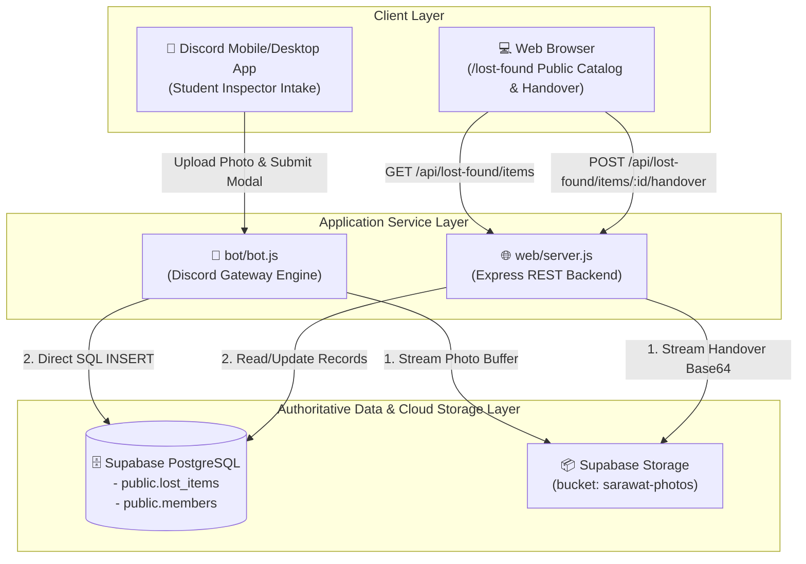
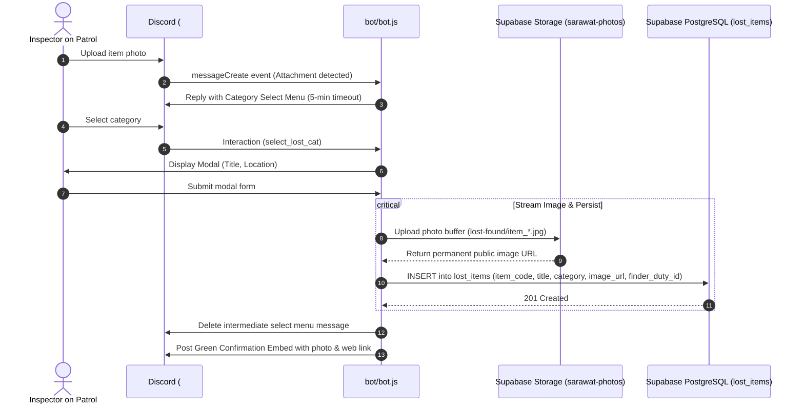
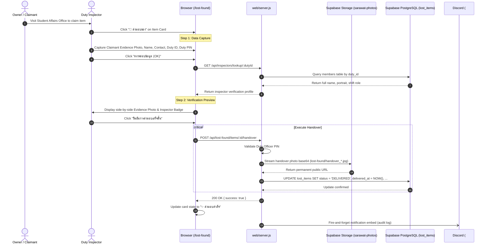

# Lost & Found System (Intake, Verification & Handover)

*   **Author:** namnuahme-maker
*   **Status:** Approved (Post-EGM Review Consensus)
*   **Date:** 2026-11-10

--------------------------------------------------------------------------------

## Overview

The Lost & Found System is an operational service for Phranarai School (โรงเรียนพระนารายณ์) managed by the Student Inspector Corps (สารวัตรนักเรียน). The system connects physical intake of lost items on campus with a public digital catalog and an auditable 2-step owner handover procedure.

The service integrates two primary user interfaces:
1.  **Discord Operations Bot**: Allows student inspectors on patrol to intake found items directly from mobile devices by posting a photo in `#📦│ของหาย-รับแจ้ง`, selecting a standardized category, and providing title and location metadata via modal dialogue.
2.  **Web Operations Dashboard**: Provides a responsive searchable public catalog (`/lost-found`) displaying item cards with inspector badges, status indicators, and a protected 2-step handover verification workflow.

## The Problem

Students and staff regularly lose personal items across the campus grounds (e.g., student wallets, wireless earbuds, keys, student uniform jackets, calculators). The historical approach relied on loose paper notebooks in the Student Affairs office (ห้องกิจการนักเรียน).

This manual process exhibits four distinct operational failures:
1.  **High Intake Latency**: Found items remain uncataloged in pockets or lockers for hours or days before reaching the central office.
2.  **Zero Verification Trail**: Claimants frequently claim items with vague verbal descriptions; inspectors have no stored proof of identity or photographic record of the physical exchange.
3.  **Accumulation of Unclaimed Property**: Items left unclaimed for extended periods accumulate indefinitely without automated policy triggers for school custody ("ของกลาง").
4.  **Operational Disconnection**: Field inspectors on duty patrol have no real-time lookup tool to check whether a reported lost item has already been turned into the headquarters.

## Goals

*   **Sub-Minute Intake Pipeline**: Reduce the time required to log and publish a found item from hours to under 60 seconds via Discord photo upload and structured modal metadata entry.
*   **Verifiable 2-Step Handover**: Enforce photographic and identity verification for every item release, capturing receiver contact information, inspector duty ID validation, Duty Officer PIN verification, and an evidence photograph.
*   **Automated Custody Escalation**: Enforce a 30-day custody policy that dynamically classifies uncollected items older than 30 days as "ของกลาง" (School Custody) during catalog query evaluation and UI badge rendering.
*   **Real-Time Mobile Catalog & Search**: Provide field inspectors and campus students with instant, debounced search and filtering across items by title, category, location, and duty code.
*   **Permanent Cloud Media Archiving**: Guarantee long-term image integrity by streaming all found item photos and handover evidence directly to persistent cloud object storage (Supabase Storage bucket `sarawat-photos`).

## Non-Goals

*   **Physical Key or Safe Automation**: The system does not interface with physical electronic locker hardware or mechanical vault locks.
*   **Monetary Rewards & Escrow**: The system does not facilitate monetary reward payments, bounties, or financial compensation between finders and owners.
*   **Public Open Uploads**: General students cannot post unvetted items directly to the official catalog; intake is restricted to student inspectors and verified school staff.
*   **Heavy Enterprise Identity Provider**: The system avoids OAuth2 server implementations, cookies, or external identity providers for student inspectors, utilizing lightweight Duty ID lookup paired with a shared Duty Officer PIN (`DUTY_OFFICER_PIN`).

## Open Questions

*   **Question 1**: Should uncollected items transitioning to "ของกลาง" after 30 days trigger an automated Discord alert to the Chief Inspector role, or rely solely on catalog badge indicators?
    *   *Resolution*: Use dynamic query-time badge rendering in Phase 1, with an optional Discord daily summary embed in future iterations.
*   **Question 2**: How should Discord CDN image URL expiration (24-hour media link signing changes) be mitigated long-term?
    *   *Resolution Resolved*: The Discord bot and Web API stream incoming images directly to Supabase Storage (`sarawat-photos/lost-found/*`), persisting only permanent, immutable cloud storage URLs in the database.

## Critical User Journeys (CUJs)

### CUJ 1: Field Inspector Intakes Found Item via Discord
*   **Given**: A student inspector on patrol discovers an unattended item (e.g., eyeglasses) on campus.
*   **When**: The inspector uploads a photo to `#📦│ของหาย-รับแจ้ง` on Discord, selects the standardized category from the dropdown menu, and inputs the title and location in the modal dialogue.
*   **Then**: The bot streams the photo buffer to Supabase Storage, records the item in Supabase PostgreSQL, publishes a confirmation embed with inspector details, and deletes the temporary dropdown prompt message to maintain channel hygiene.

### CUJ 2: Claimant Recovers Item through 2-Step Handover Modal
*   **Given**: An owner identifies their lost property on the `/lost-found` web dashboard and visits the Student Affairs office.
*   **When**: The duty inspector clicks "🤝 ส่งมอบของ", captures an evidence photo of the claimant holding the item, inputs claimant contact details, enters their inspector duty code (e.g., `TS1`) and Duty Officer PIN, reviews the side-by-side preview, and confirms the release.
*   **Then**: The Web API streams the evidence photo to Supabase Storage, transitions the item status to `DELIVERED`, records the timestamp and audit details, and updates the public card to show successful return.

### CUJ 3: Field Inspector Performs Real-Time Campus Search
*   **Given**: A student approaches an inspector on field patrol asking if their lost AirPods have been turned in.
*   **When**: The inspector accesses `/lost-found` on their mobile smartphone, taps the "อุปกรณ์ไอที" filter pill, and types "AirPods" into the live search bar.
*   **Then**: The catalog instantly filters matches, displaying storage location (e.g., "ห้องสารวัตรนักเรียน อาคาร 1"), photo thumbnail, and the on-duty inspector who logged the item.

### CUJ 4: Duty Inspector Reviews Confiscated School Custody ("ของกลาง")
*   **Given**: An inspector conducts a monthly inventory check of the physical lost-and-found locker.
*   **When**: The inspector selects the "⚖️ ของกลาง" filter toggle on the dashboard.
*   **Then**: The system queries all `WAITING_OWNER` items logged more than 30 days ago, highlighting them with red borders and `⏱️ (เกิน 30 วัน)` badges for transfer to administrative school custody.

--------------------------------------------------------------------------------

## Technical Plan (Architecture)

### 1. System Topology & Component Boundaries

The system consolidates data persistence into a **Single Source of Truth** (Supabase PostgreSQL and Supabase Object Storage), eliminating multi-master HTTP sprays and ephemeral container disk synchronization.



### 2. End-to-End Execution Lifecycles

#### 2.1 Found Property Intake Pipeline



#### 2.2 Verifiable 2-Step Handover Protocol



### 3. Data Contracts & Schema Specification

#### 3.1 Primary Entity: `public.lost_items`

```sql
CREATE TABLE IF NOT EXISTS public.lost_items (
    id UUID PRIMARY KEY DEFAULT gen_random_uuid(),
    item_code VARCHAR(50) UNIQUE NOT NULL,             -- Unique tactical code (e.g., LF-2026-A1B2)
    title VARCHAR(200) NOT NULL,                       -- Item name (e.g., กระเป๋าสตางค์หนัง Tough)
    category VARCHAR(100) NOT NULL,                    -- Standardized category label
    characteristics TEXT DEFAULT '',                   -- External physical traits (color, brand, flaws)
    secret_traits TEXT DEFAULT '',                     -- Confidential inspector verification marker
    image_url TEXT NOT NULL,                           -- Permanent Supabase Storage public URL
    location_found VARCHAR(200) DEFAULT '-',           -- Found location on campus
    found_date DATE NOT NULL DEFAULT CURRENT_DATE,     -- Date found (YYYY-MM-DD)
    found_time VARCHAR(50),                            -- Time found string (e.g., 11:04 น.)
    status VARCHAR(50) DEFAULT 'WAITING_OWNER',        -- WAITING_OWNER | DELIVERED
    storage_location VARCHAR(200) DEFAULT 'ห้องสารวัตรนักเรียน อาคาร 1',
    finder_name VARCHAR(150),                          -- Reporting inspector full name
    finder_duty_id VARCHAR(50),                        -- Inspector duty code (e.g., TS1)
    finder_avatar_url TEXT,                            -- Reporting inspector portrait URL
    finder_contact VARCHAR(100),                       -- Inspector contact number or line ID
    claimant_name VARCHAR(150),                        -- Recipient claimant name
    claimant_contact VARCHAR(100),                     -- Recipient phone number or contact
    delivered_by VARCHAR(150),                         -- Handover executing inspector
    delivered_by_duty_id VARCHAR(50),                  -- Executing inspector duty code
    delivered_by_photo_url TEXT,                       -- Executing inspector portrait URL
    handover_photo_url TEXT,                           -- Permanent Supabase Storage handover evidence URL
    delivered_at TIMESTAMPTZ,                          -- Handover timestamp
    handover_notes TEXT,                               -- Verification audit notes
    created_at TIMESTAMPTZ DEFAULT NOW(),
    updated_at TIMESTAMPTZ DEFAULT NOW()
);

-- Performance Indexes
CREATE INDEX IF NOT EXISTS idx_lost_items_status ON public.lost_items(status);
CREATE INDEX IF NOT EXISTS idx_lost_items_category ON public.lost_items(category);
CREATE INDEX IF NOT EXISTS idx_lost_items_found_date ON public.lost_items(found_date);
CREATE INDEX IF NOT EXISTS idx_lost_items_code ON public.lost_items(item_code);

-- Security: Row Level Security (RLS)
ALTER TABLE public.lost_items ENABLE ROW LEVEL SECURITY;
CREATE POLICY "Allow public read lost_items" ON public.lost_items FOR SELECT USING (true);
CREATE POLICY "Allow service role write lost_items" ON public.lost_items FOR ALL USING (auth.role() = 'service_role');
```

#### 3.2 Standardized Static Categories

To prevent dynamic database bloat and schema complexity, categories are fixed constants:

```javascript
const LOST_CATEGORIES = [
  { id: 'BAG', name: 'กระเป๋า / กระเป๋าสตางค์', icon: '👛' },
  { id: 'TECH', name: 'อุปกรณ์ไอที / มือถือ', icon: '📱' },
  { id: 'KEY', name: 'กุญแจ / ยานพาหนะ', icon: '🔑' },
  { id: 'CLOTH', name: 'เครื่องแต่งกาย / หมวก', icon: '👕' },
  { id: 'STUDY', name: 'เครื่องเขียน / หนังสือ', icon: '📚' },
  { id: 'VALUABLE', name: 'ของมีค่า / เครื่องประดับ', icon: '💎' },
  { id: 'CONFISCATED', name: 'ของกลาง', icon: '⚖️' },
  { id: 'OTHER', name: 'สิ่งของทั่วไป / อื่นๆ', icon: '📦' }
];
```

#### 3.3 Business Rules & 30-Day Custody Escalation

Uncollected property is evaluated dynamically during catalog retrieval:
```sql
-- Query condition for school custody items
status = 'WAITING_OWNER' AND (
    category = 'ของกลาง' OR 
    found_date <= (CURRENT_DATE - INTERVAL '30 days')
)
```
*   **Status Isolation**: Items marked `DELIVERED` are never classified as confiscated, regardless of elapsed age.
*   **Visual Treatment**: Eligible items display `border-rose-900/60`, an active pulse badge `⏱️ (เกิน 30 วัน)`, and the `⚖️ ของกลาง` category indicator.

### 4. REST API Endpoints & Contracts

| Method | Endpoint | Description | Request Body / Query | Success Response |
|---|---|---|---|---|
| `GET` | `/api/lost-found/items` | Query catalog with public field projection | `?category=...&status=...&search=...` | `200 OK: { success: true, count: N, data: [...] }` *(Excludes `secret_traits`)* |
| `POST` | `/api/lost-found/items` | Ingest newly found item | JSON: `title, category, characteristics, location_found, image_url, finder_duty_id` | `201 Created: { success: true, item: {...} }` |
| `GET` | `/api/inspectors/lookup/:dutyId` | Lookup inspector credentials | URL Param: `dutyId` (e.g., `TS1`) | `200 OK: { success: true, found: true, member: { full_name, photo_url, shift_role } }` |
| `POST` | `/api/lost-found/items/:id/handover` | Commit verifiable delivery | JSON: `claimant_name, claimant_contact, delivered_by_duty_id, duty_pin, handover_photo_base64` | `200 OK: { success: true, message: "ส่งมอบสำเร็จ" }` |

> [!IMPORTANT]
> The administrative wipe route `POST /api/lost-found/killfile` is removed from the public Express server. System wipes are executed exclusively via the Discord `/killfile` slash command, protected by native Discord Administrator permission checks and interactive confirmation modals.

### 5. Architectural Resilience & Failure Mitigation

1.  **Permanent Object Storage**: All media assets stream directly to Supabase Storage `sarawat-photos`, eliminating link decay from Discord CDN URL signing.
2.  **Single Source of Truth**: Removes dual-write HTTP POST sprays and ephemeral local JSON files, avoiding split-brain drift and container restart wipes.
3.  **Synthetic Event Isolation**: Handover dialog click-outside handlers explicitly evaluate `event.target === dialog && event.isTrusted` to prevent synthetic click events (from hidden `<input type="file">` elements) from terminating the active modal.
4.  **Channel Hygiene Enforcement**: Ephemeral bot prompt messages register a 5-minute garbage collection timer and are explicitly purged upon modal submission.
5.  **Data Privacy on Sensitive Traits**: `secret_traits` is omitted from public catalog queries, preserving confidential markers for verification at the Student Affairs office.

--------------------------------------------------------------------------------

## Alternatives Considered

### Alternative A: Google Forms and Google Sheets Spreadsheet Workflow
*   **Description**: Rely on a standardized Google Form for found property intake feeding into Google Sheets.
*   **Pros**: Zero backend server infrastructure.
*   **Cons**: High intake friction on patrol; no real-time inspector duty code validation; cannot support the 2-step photo verification modal.
*   **Rejection Rationale**: Field inspectors coordinate daily duties on Discord; shifting intake to external forms introduces friction that leads to unlogged items.

### Alternative B: Dedicated Native Mobile Application (Flutter / React Native)
*   **Description**: Develop and distribute an independent iOS and Android application dedicated to campus lost and found.
*   **Pros**: Direct device camera hardware access.
*   **Cons**: App store distribution friction; high maintenance overhead for a secondary school extracurricular student corps; claimants must download an app just to check a lost wallet.
*   **Rejection Rationale**: Heavy deployment and platform maintenance costs without proportional utility. Utilizing Discord for inspectors and a responsive web dashboard for students solves the problem with zero installation barrier.

### Alternative C: Discord-Only Bot Architecture (No Web Dashboard)
*   **Description**: Handle all intake, catalog querying, and delivery verification exclusively via Discord commands and forum channels.
*   **Pros**: Consolidates logic into a single runtime.
*   **Cons**: Inaccessible to non-Discord students, parents, and administrative staff; chat feeds become cluttered when browsing hundreds of accumulated items.
*   **Rejection Rationale**: The public catalog must be universally accessible across campus library terminals and student smartphones without requiring a Discord login.

--------------------------------------------------------------------------------

## Detailed Implementation Plan

### 1. Touched Files & Architectural Rationale

| File Path | Action | Rationale |
|---|---|---|
| [`sql/migration_v6_lost_and_found.sql`](file:///c:/Users/NAMNUAH/Desktop/SARAWAT/sql/migration_v6_lost_and_found.sql) | Modify | Clean DDL for `public.lost_items` with RLS policies, performance indexes, and no orphaned tables. |
| [`web/server.js`](file:///c:/Users/NAMNUAH/Desktop/SARAWAT/web/server.js) | Modify | Implements REST endpoints for items, inspector lookup, and handover execution with Duty PIN validation and Supabase Storage streaming. |
| [`bot/bot.js`](file:///c:/Users/NAMNUAH/Desktop/SARAWAT/bot/bot.js) | Modify | Implements Discord photo intake, streams buffer to Supabase Storage, registers modal, and executes single authoritative DB insert. |
| [`DESIGN_SYSTEM_RULES.md`](file:///c:/Users/NAMNUAH/Desktop/SARAWAT/DESIGN_SYSTEM_RULES.md) | Verify | Enforces Midnight Tactical palette (`midnight-950` to `midnight-600`) and dialog interaction contracts. |
| [`web/public/lost-found.html`](file:///c:/Users/NAMNUAH/Desktop/SARAWAT/web/public/lost-found.html) | Modify | Implements responsive catalog, search/category filter pills, inspector badges, and 2-step handover modal with Duty PIN input. |
| [`bot/test/bot.test.js`](file:///c:/Users/NAMNUAH/Desktop/SARAWAT/bot/test/bot.test.js) | Modify | Automated unit tests covering Discord intake events, modal length guards, and `/killfile` confirmation gates. |
| [`web/test/server.test.js`](file:///c:/Users/NAMNUAH/Desktop/SARAWAT/web/test/server.test.js) | Create | Automated unit tests covering API endpoints, projection security, and 30-day escalation query logic. |

### 2. Unified Implementation Execution Sequence

#### Phase 1: Database Schema & Migration Foundation
1.  **Draft Migration Script**: Update `sql/migration_v6_lost_and_found.sql` declaring `public.lost_items` with UUID primary keys, unique `item_code` constraint, and timestamps.
2.  **Prune Dead Schema**: Exclude `public.lost_claims` and `public.lost_categories`.
3.  **Define Security & Indices**: Enable Row Level Security (RLS) with public SELECT and service-role write policies; create indexes on `status`, `category`, `found_date`, and `item_code`.

#### Phase 2: Web Server REST API & Handover Service
1.  **Define Static Categories**: Embed `LOST_CATEGORIES` constant array in `web/server.js`.
2.  **Implement Catalog Retrieval (`GET /api/lost-found/items`)**:
    *   Query Supabase `lost_items` ordered by `created_at DESC`.
    *   Project public fields, omitting `secret_traits`.
    *   Support text query search matching `title`, `item_code`, `location_found`, and `characteristics`.
3.  **Implement Inspector Lookup (`GET /api/inspectors/lookup/:dutyId`)**:
    *   Query `members` table in Supabase matching `duty_id` (case-insensitive).
    *   Return inspector portrait URL, full name, nickname, and shift role.
4.  **Implement Handover Execution (`POST /api/lost-found/items/:id/handover`)**:
    *   Verify `duty_pin` matches `process.env.DUTY_OFFICER_PIN`.
    *   Stream Base64 handover evidence photo to `sarawat-photos/lost-found/handover_*.jpg` in Supabase Storage.
    *   Update item status to `DELIVERED` with recipient details and executing inspector credentials.
5.  **Remove Destructive HTTP Route**: Delete `/api/lost-found/killfile` from Express router.

#### Phase 3: Discord Bot Intake & Channel Operations
1.  **Detect Photo Messages**: Attach listener in `bot/bot.js` within `messageCreate` filtering for non-bot image attachments inside `#📦│ของหาย-รับแจ้ง`.
2.  **Publish Category Selector**: Generate `reportId`, store temporary state in `pendingLostReports`, and reply with a `StringSelectMenuBuilder` populated from `LOST_CATEGORIES`.
3.  **Register 5-Minute GC Timer**: Bind a `setTimeout` to delete the intermediate selector message after 5 minutes if unhandled.
4.  **Display Modal on Selection**: Catch `select_lost_cat_${reportId}` interaction and present a 2-field modal for item title and location.
5.  **Handle Modal Submission**:
    *   Fetch Discord attachment buffer and upload to Supabase Storage `sarawat-photos/lost-found/item_*.jpg`.
    *   Generate collision-proof item code: `LF-${new Date().getFullYear()}-${crypto.randomBytes(2).toString('hex').toUpperCase()}`.
    *   Resolve inspector details from Supabase `members` using Discord user ID.
    *   Execute single authoritative `INSERT` into `supabase.from('lost_items')`.
    *   Delete the initial prompt select menu message from the channel.
    *   Publish green confirmation embed with photo thumbnail and public catalog URL.

#### Phase 4: Frontend Catalog & 2-Step Handover Interface
1.  **Establish Design Rules**: Verify tokens in `DESIGN_SYSTEM_RULES.md`.
2.  **Build Navigation & Filter Bar in `web/public/lost-found.html`**:
    *   Live search input with instant debounced catalog filtering.
    *   Category pill selector driven by static categories.
    *   Status filter toggles (`ทั้งหมด`, `🟢 รอรับที่ห้องกิจการ`, `✨ ส่งมอบสำเร็จ`, `⚖️ ของกลาง`).
3.  **Build Showcase Grid**:
    *   Render cards with 4:3 photo containers, status badges, inspector portrait avatar, and duty code tag.
    *   Mount "🤝 ส่งมอบของ" button for pending items.
4.  **Build 2-Step Handover Modal**:
    *   Step 1: Photo capture zone with preview, claimant name, contact number, inspector duty ID, and Duty PIN input.
    *   Step 2: Verification screen showing side-by-side evidence photo and authenticated inspector portrait with confirm button.
5.  **Harden Dialog Click Mechanics**:
    *   Enforce Light Dismiss check: `event.target === dialog && event.isTrusted` to avoid accidental dismissal during file upload dialog interactions.
    *   Attach `event.stopPropagation()` to file input triggers.

#### Phase 5: Verification & Automated QA
1.  **Bot Automated Unit Tests**: Execute `npm --prefix bot test` to verify slash commands, modal label length constraints (<= 45 chars), and `pendingLostReports` memory lifecycle.
2.  **Web API Automated Tests**: Execute `node --test web/test/server.test.js` to verify:
    *   `GET /api/lost-found/items` returns 200 OK and excludes `secret_traits`.
    *   `GET /api/inspectors/lookup/:dutyId` returns inspector profile.
    *   `POST /api/lost-found/items/:id/handover` validates Duty PIN and transitions state to `DELIVERED`.
3.  **End-to-End Headless Verification**: Run Puppeteer automation against `http://localhost:10001/lost-found` verifying:
    *   Catalog initial load and item count display.
    *   Modal open and close behaviors.
    *   File upload dropzone click persistence (`open: true`).
    *   Backdrop click dismissal.
4.  **Deployment Verification**: Push commits to GitHub `main` for `sarawat-pranarai-bot` and `sarawat-pranarai-web-` repositories; monitor Render build and deploy hooks.
